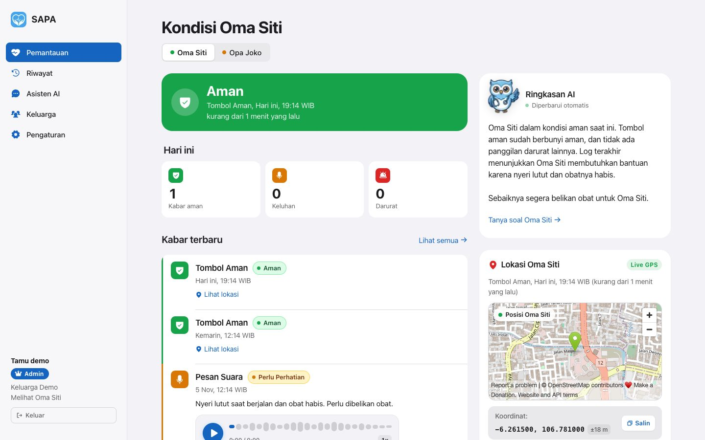

# SAPA: Sistem Asisten Pantau Aktif

Aplikasi pemantauan orang tua jarak jauh. Orang tua menekan satu dari tiga tombol besar; keluarga langsung melihat kabarnya di dashboard. Tanpa kata sandi, tanpa menu rumit.

Dibuat untuk HIMTEC Build App 2026.

| | |
|---|---|
| Aplikasi orang tua | PWA di `/lansia`: Saya Aman, Keluhan, Darurat |
| Dashboard keluarga | `/pengawas` ("Pemantauan"): status, lokasi, riwayat, asisten AI |
| Tiga peran | Admin (mengelola), Pemantau (melihat), Lansia (melapor) |
| AI | Triase pesan suara, ringkasan, sapaan maskot, tanya jawab |
| Stack | Next.js 16, React 19, Prisma 6, PostgreSQL (Supabase), OrcaRouter (Gemini 2.5) |



## Coba cepat

```bash
npm install
cp .env.example .env     # isi nilai; lihat "Konfigurasi"
npx prisma db push
npm run dev              # http://localhost:3000
```

Buka `http://localhost:3000/demo`: satu klik memasang dua sesi (admin keluarga contoh dan HP Oma Siti) dan menampilkannya berdampingan. Skenario pengujian ada di [docs/PANDUAN_JURI.md](docs/PANDUAN_JURI.md).

## Tiga peran

| Peran | Masuk lewat | Melakukan |
|---|---|---|
| Admin | `/daftar` | Mendaftarkan keluarga; mengelola orang tua, kode, dan peran anggota |
| Pemantau | `/gabung` dengan kode undangan | Melihat kabar, lokasi, riwayat; bertanya ke asisten |
| Lansia | `/hubungkan` dengan kode pairing | Memakai tiga tombol di HP |

Pemisahan peran ditegakkan di server pada setiap request. Detail: [docs/PRODUK.md](docs/PRODUK.md).

## Konfigurasi

Salin `.env.example` ke `.env`:

| Variabel | Wajib | Keterangan |
|---|---|---|
| `DATABASE_URL` | Ya | Supabase pooler, port 6543 (runtime) |
| `DIRECT_URL` | Untuk migrasi | Koneksi langsung, port 5432 |
| `SESSION_SECRET` | Ya | Minimal 32 karakter acak: `openssl rand -base64 48` |
| `ORCA_API_KEY` | Disarankan | Tanpa kunci, fitur AI memakai teks cadangan |
| `ENABLE_DEMO` | Tidak | `true` menyalakan `/demo` di produksi (default: mati) |

Jangan commit `.env`. Server memvalidasi konfigurasi saat start dan berhenti dengan pesan jelas di produksi bila salah.

## Perintah

```bash
npm run dev       # server pengembangan
npm run build     # build produksi
npm run start     # sajikan hasil build
npm run lint      # ESLint
npm test          # tes unit (tanpa database)
npm run db:push   # sinkronkan skema
npm run db:seed   # data demo
```

## Struktur

```
src/
  app/          halaman dan route handler (/api/*)
  features/     antarmuka per fitur: lansia, pengawas, masuk
  components/   komponen bersama
  services/     aturan bisnis dan akses data
  lib/          utilitas dan infrastruktur
prisma/         skema dan migrasi SQL
docs/           dokumentasi lengkap
tests/          tes unit
```

Penjelasan lapisan dan aturan dependensi: [docs/ARSITEKTUR.md](docs/ARSITEKTUR.md).

## Dokumentasi

| | |
|---|---|
| [Produk](docs/PRODUK.md) | Masalah, peran, fitur, alur |
| [Arsitektur](docs/ARSITEKTUR.md) | Lapisan, alur request, AI, keputusan desain |
| [API](docs/API.md) | Referensi endpoint |
| [Database](docs/DATABASE.md) | Model, constraint, RLS, migrasi |
| [Keamanan](docs/KEAMANAN.md) | Kontrol dan batasan yang diterima |
| [Pengembangan](docs/PENGEMBANGAN.md) | Konvensi, tes, menambah fitur |
| [Produksi](docs/PRODUKSI.md) | Deploy, daftar periksa rilis, pemantauan, rollback |
| [Panduan juri](docs/PANDUAN_JURI.md) | Demo satu klik dan skenario uji |
| [Laporan](readthis.md) | Latar belakang, use case, analisis |

## Deploy

Vercel, wilayah `bom1` (dekat database). Langkah lengkap dan daftar periksa rilis: [docs/PRODUKSI.md](docs/PRODUKSI.md). Pemeriksaan kesehatan: `GET /api/health`.

## Kontribusi

1. Buat cabang dari `main`.
2. Ikuti konvensi di [docs/PENGEMBANGAN.md](docs/PENGEMBANGAN.md).
3. Pastikan `npm run lint`, `npm test`, dan `npm run build` lolos (CI menjalankan ketiganya).
4. Perbarui dokumen yang terdampak dalam PR yang sama.

Melaporkan celah keamanan: lihat [docs/KEAMANAN.md](docs/KEAMANAN.md).

## Lisensi

Hak cipta pada tim pengembang SAPA. Hubungi pemilik repositori untuk penggunaan di luar penilaian lomba.
