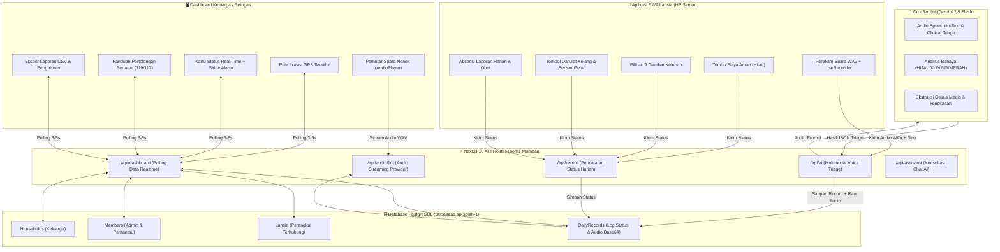
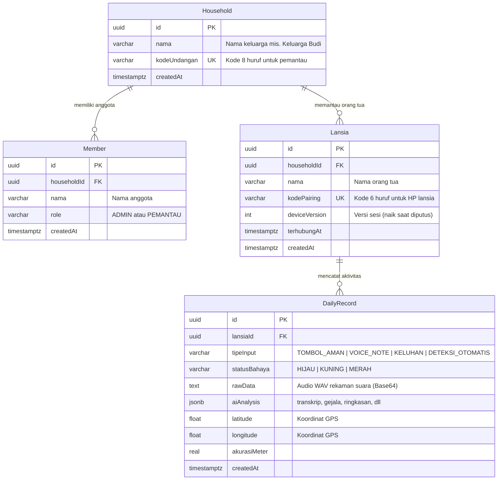

# 🏛️ Arsitektur Teknis — SAPA (Sistem Asisten Pantau Aktif)

Dokumen ini menjelaskan rancangan sistem, model data, alur pemrosesan AI, dan strategi keamanan pada aplikasi **SAPA**.

---

## 1. Diagram Alur Sistem (System Flowchart)

---

## 2. Struktur Model Database (Entity Relationship)

Aplikasi menggunakan **Prisma 6** dengan target **PostgreSQL (Supabase)**. Seluruh relasi menerapkan `onDelete: Cascade` agar penghapusan data bersih tanpa *orphaned records*.

---

## 3. Alur Pemrosesan Suara & Voice Triage (`/api/ai`)

1. **Perekaman di Klien (`useRecorder.js`)**:
   - Merekam suara melalui `MediaRecorder` API.
   - Menggunakan `OfflineAudioContext` untuk mengonversi format browser (WebM/MP4) menjadi **WAV Mono 16 kHz** standar (~32 KB/detik).
2. **Pengiriman & Penyimpanan**:
   - Audio dikirim ke server dalam bentuk Base64 string via `POST /api/ai`.
   - String Base64 audio disimpan di kolom `DailyRecord.rawData` sehingga keluarga dapat memutar ulang suara asli nenek kapan saja.
3. **Analisis AI Multimodal (`triage.service.js`)**:
   - Dikirim ke model `gemini-2.5-flash` lewat OrcaRouter.
   - Prompt sistem bertindak sebagai perawat triase geriatri:
     - **MERAH**: Gejala serangan jantung, sesak, jatuh, pingsan, bicara pelo, kejang.
     - **KUNING**: Nyeri, demam, mual, obat habis, susah tidur, kesepian.
     - **HIJAU**: Konfirmasi kondisi sehat/aman.
   - Menghasilkan respon JSON: `transkrip`, `gejala`, `statusBahaya`, `ringkasan`.
4. **Fallback Resilience**:
   - Jika OrcaRouter tidak merespons atau terjadi batas kuota/timeout, sistem secara otomatis mengembalikan status aman cadangan (**KUNING**) dengan pesan agar keluarga segera menelepon langsung. Tidak ada pesan lansia yang hilang.

---

## 4. Keamanan & Autentikasi Tanpa Kata Sandi

- Menggunakan **Signed Session Cookies** (`sapa-pengawas` dan `sapa-lansia`) berbasis **HMAC-SHA256 (Web Crypto API)**.
- `httpOnly: true`, `sameSite: 'lax'`, `secure: true` pada HTTPS.
- Masa berlaku sesi 1 tahun untuk memastikan HP orang tua tetap terhubung tanpa perlu berulang kali login.
- **In-flight Device Versioning**: Jika admin menekan "Putuskan HP", kolom `deviceVersion` pada baris Lansia dinaikkan (+1). Sesi cookie lama pada HP yang hilang/diganti otomatis ditolak seketika pada request berikutnya.
- **Row-Level Security (RLS)** diaktifkan pada semua tabel database Supabase untuk memblokir akses langsung di luar Prisma ORM server.
