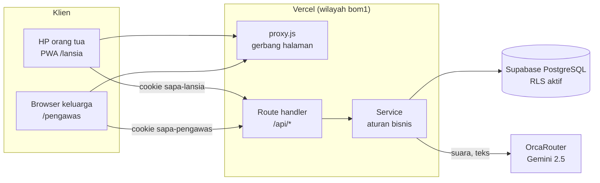
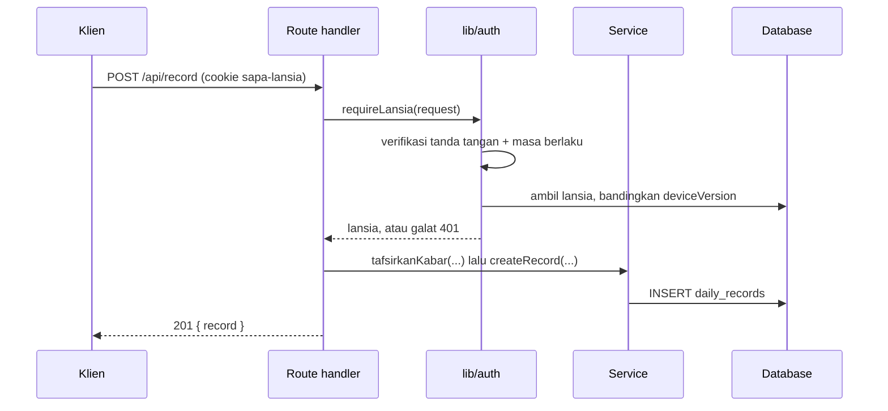

# Arsitektur

## Gambaran

Satu aplikasi Next.js (App Router) melayani tiga hal: halaman web, aplikasi orang tua (PWA), dan API. Data disimpan di PostgreSQL (Supabase) lewat Prisma. AI dipanggil dari server lewat OrcaRouter (API kompatibel OpenAI).



Wilayah fungsi (`bom1`, Mumbai) disamakan dengan wilayah database agar setiap query hanya puluhan milidetik. Dari wilayah yang jauh, satu query bisa mencapai 2 detik.

## Lapisan dan aturan dependensi

```
src/app/            Halaman dan route handler. Tipis: validasi input, panggil service, bentuk respons.
src/features/       Antarmuka per fitur (lansia, pengawas, masuk). Komponen React.
src/components/     Komponen bersama (Mascot, RolePill, StatusBadge, ...).
src/hooks/          Hook bersama (useRecorder, useDeteksiGerak).
src/services/       Aturan bisnis dan akses data. Tidak mengenal HTTP.
src/lib/            Utilitas murni dan infrastruktur (auth, sesi, db, kode, validasi).
prisma/             Skema dan migrasi SQL.
```

Arah dependensi satu arah: `app` dan `features` boleh memakai `services` dan `lib`; `services` boleh memakai `lib`; `lib` tidak memakai lapisan di atasnya. Kode `features/` tidak pernah mengimpor `services/` atau `db`: ia hanya bicara dengan API lewat `fetch`.

Aturan praktis:

- Route handler tidak berisi aturan bisnis. Contoh: `app/api/record/route.js` memanggil `tafsirkanKabar` (service) lalu `createRecord`.
- Galat yang disebabkan input klien dilempar sebagai `ValidationError` (`lib/errors.js`) dan dipetakan ke HTTP 400. Galat tak terduga dicatat dan dikembalikan sebagai 500 dengan pesan umum.
- Status bahaya tidak pernah datang dari klien. Server menentukannya dari jenis kabar dan daftar keluhan.

## Struktur folder

```
src/
  app/
    api/                 Route handler (lihat API.md)
    daftar/ gabung/ hubungkan/ lansia/ pengawas/ demo/ panduan/   Halaman
    global-error.js      Batas galat terakhir (layout akar)
    error.js not-found.js layout.js globals.css
  features/
    lansia/              LansiaApp.js merangkai hooks/ dan components/; teks.js berisi bagian murni
    pengawas/            Shell, RecordsProvider (polling), tampilan dashboard
    masuk/               Gateway dan formulir masuk
  components/ui/         Mascot, RolePill, StatusBadge, ShareCode, AudioPlayer, Wordmark
  hooks/                 useRecorder, useDeteksiGerak
  services/
    household.service.js   Keluarga, anggota, orang tua, kode
    record.service.js      Simpan dan baca kabar
    kabar.service.js       Aturan status untuk kabar non-suara
    triage.service.js      Suara -> transkrip + status (AI)
    mascot.service.js      Sapaan harian (AI + teks cadangan)
    assistant.service.js   Tanya jawab keluarga (AI)
    demo.service.js        Data keluarga demo
  lib/                   auth, session, codes, rate-limit, validate, lokasi, geo, format,
                         orca, errors, constants, keluhan, deteksi, siren, http, env, flags, db
  instrumentation.js     Validasi env saat server mulai
  proxy.js               Gerbang halaman (pengganti middleware di Next.js 16)
prisma/                  schema.prisma, setup.sql, seed.js, sql/ (migrasi)
tests/                   Tes unit (node:test)
```

## Alur request terautentikasi



Peran tidak dipercaya dari cookie. Cookie hanya berisi id; peran dan keanggotaan dibaca dari database pada setiap request, sehingga perubahan peran atau pemutusan HP berlaku seketika.

## Pemrosesan suara

1. `hooks/useRecorder.js` merekam lewat `MediaRecorder`, lalu mengubahnya ke WAV mono 16 kHz dengan `OfflineAudioContext` (sekitar 32 KB per detik, maksimum 30 detik).
2. Klien mengirim base64 ke `POST /api/ai` (batas `MAX_AUDIO_BASE64_LENGTH`, sekitar 4,5 MB audio).
3. `triage.service.js` mengirim audio ke model `google/gemini-2.5-flash` dengan instruksi triase geriatri dan meminta JSON: `transkrip`, `gejala`, `statusBahaya`, `ringkasan`.
4. Rekaman asli disimpan di `daily_records.raw_data` supaya keluarga dapat memutarnya (`GET /api/audio/[id]`, mendukung HTTP Range untuk Safari).
5. Bila AI gagal atau melewati batas waktu, kabar tetap tersimpan dengan status KUNING dan pesan agar keluarga segera menelepon. Pesan orang tua tidak pernah hilang karena AI mati.

Teks (sapaan maskot, asisten, ringkasan) memakai `google/gemini-2.5-flash-lite`. Setiap pemanggilan AI punya teks cadangan non-AI.

## Rendering dan caching (Next.js 16)

- `cacheComponents` aktif: akses data dinamis harus lewat `Suspense` atau `use cache`.
- Route handler yang membaca cookie memanggil `await connection()` agar ditandai dinamis.
- Halaman yang membaca `searchParams` dibungkus `Suspense`.
- `/demo` dan tautan keluar yang mengubah state memakai `<a>` biasa, bukan `<Link>`, supaya tidak ikut di-prefetch.
- Nilai `demoAktif()` yang dibaca saat build menentukan tautan demo di beranda; variabel `ENABLE_DEMO` harus sudah ada saat build (di Vercel otomatis).

## Pembaruan data di dashboard

`features/pengawas/RecordsProvider.js` memuat `/api/dashboard` berkala. Tiga pengaman mencegah penumpukan request ke database:

- tidak memuat saat tab tersembunyi,
- tidak memulai pemuatan baru selama satu pemuatan masih berjalan,
- urutan permintaan: respons lama yang terlambat dibuang.

## Keputusan desain

| Keputusan | Alasan | Konsekuensi |
|---|---|---|
| Tanpa kata sandi; kode pendek | Orang tua tidak perlu mengingat kredensial | Keamanan bergantung pada kerahasiaan kode dan pembatasan laju |
| Cookie bertanda tangan HMAC, bukan JWT/Auth0 | Sederhana, tanpa dependensi, dapat dicabut lewat `deviceVersion` | Rotasi `SESSION_SECRET` mengeluarkan semua pengguna |
| Peran dibaca dari DB tiap request | Pencabutan seketika | Satu query tambahan per request |
| Status ditentukan server | Klien tidak bisa memalsukan status | Daftar keluhan dipakai bersama di `lib/keluhan.js` |
| Polling, bukan WebSocket/push | Cukup untuk skala keluarga, sederhana di serverless | Kabar muncul dalam hitungan detik, bukan seketika |
| Audio disimpan di kolom DB | Tanpa layanan penyimpanan tambahan | Baris besar; pindah ke object storage bila volume naik |
| Pembatas laju dalam memori | Tanpa infrastruktur tambahan | Tidak akurat lintas instance; lihat [KEAMANAN.md](KEAMANAN.md) |
| Migrasi SQL manual di `prisma/sql/` | Kontrol penuh atas constraint dan RLS | Harus dijalankan berurutan di SQL Editor |
