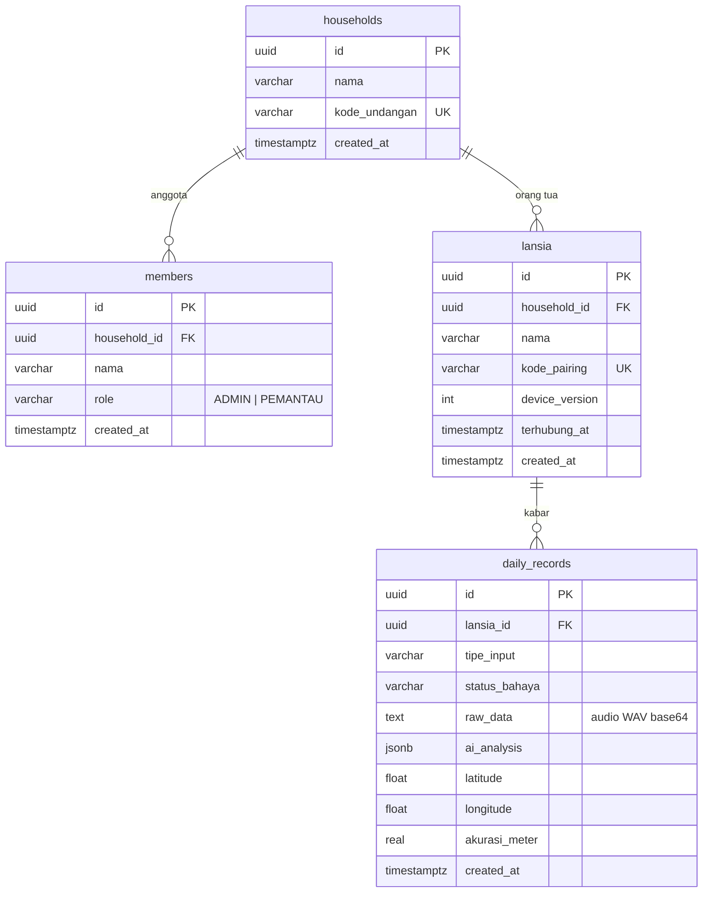

# Database

PostgreSQL di Supabase, diakses hanya dari server lewat Prisma 6. Skema sumber ada di `prisma/schema.prisma`; SQL lengkap siap tempel ada di [`schema.sql`](schema.sql) (salinan identik dari `prisma/setup.sql`, dijaga oleh tes).

## Relasi

Menghapus satu keluarga menghapus seluruh anggota, orang tua, dan kabarnya (`ON DELETE CASCADE`). Menghapus satu orang tua menghapus kabarnya.

## Tabel

### households

| Kolom | Catatan |
|---|---|
| `kode_undangan` | 8 karakter, unik. Dibagikan admin ke calon pemantau. |

### members

| Kolom | Catatan |
|---|---|
| `role` | `CHECK (role IN ('ADMIN','PEMANTAU'))`, default `PEMANTAU`. Setiap keluarga harus punya minimal satu admin; aturan ini ditegakkan di service. |

Tidak ada kolom email, telepon, atau kata sandi. Anggota diidentifikasi oleh cookie sesi.

### lansia

| Kolom | Catatan |
|---|---|
| `kode_pairing` | 6 karakter, unik. Dimasukkan di HP orang tua. |
| `device_version` | Naik saat HP diputus. Cookie lama memuat versi lama sehingga langsung ditolak. |
| `terhubung_at` | Terakhir kali HP tersambung; kosong bila belum pernah. |

### daily_records

| Kolom | Catatan |
|---|---|
| `tipe_input` | `TOMBOL_AMAN`, `TOMBOL_DARURAT`, `VOICE_NOTE`, `KELUHAN`, `DETEKSI_OTOMATIS` (dibatasi `CHECK`) |
| `status_bahaya` | `HIJAU`, `KUNING`, `MERAH` (dibatasi `CHECK`) |
| `raw_data` | Audio WAV base64 untuk pesan suara; kosong untuk jenis lain |
| `ai_analysis` | JSONB: `transkrip`, `gejala`, `ringkasan`, `sumber`, `otomatis`, `sebab` (bergantung jenis) |
| `latitude`, `longitude`, `akurasi_meter` | Lokasi HP saat kabar dikirim; kosong bila izin tidak diberikan. `CHECK` rentang -90..90, -180..180, akurasi >= 0 |

Indeks: `(lansia_id, created_at DESC)` untuk riwayat dan `status_bahaya`.

Kolom `lansia_id` dapat bernilai null hanya untuk baris lama dari sebelum ada konsep keluarga; seluruh query memfilter `lansia_id`.

## Isolasi data antar keluarga

Prisma terhubung sebagai peran database dengan hak penuh, jadi isolasi keluarga bukan dari RLS melainkan dari kode: setiap query dimulai dari `household_id` milik sesi (`lansiaMilik`, `anggotaMilik`, dan `where: { lansia: { householdId } }`). Untuk endpoint audio, kepemilikan diperiksa dalam query yang sama.

## Row Level Security

RLS diaktifkan pada keempat tabel tanpa policy. Dampaknya: kunci `anon` dan `authenticated` Supabase (bila bocor atau dipakai lewat REST API Supabase) tidak bisa membaca atau menulis apa pun. Hanya koneksi Prisma dari server yang bekerja. Uji: permintaan REST dengan kunci anon ke tabel mana pun mengembalikan 401/kosong.

## Menyiapkan database baru

1. Buat project Supabase (lihat [supabase-setup.txt](supabase-setup.txt)).
2. Isi `.env` (`DATABASE_URL` port 6543 untuk runtime, `DIRECT_URL` port 5432 untuk migrasi).
3. Pilih salah satu:
   - Tempel isi [`schema.sql`](schema.sql) di SQL Editor Supabase (menyertakan constraint, indeks, dan RLS), atau
   - `npx prisma db push`, lalu jalankan bagian RLS dari `schema.sql`.
4. Opsional: `npm run db:seed` untuk keluarga demo.

## Migrasi untuk database yang sudah berjalan

Migrasi hand-written ada di `prisma/sql/`, bernama `TANGGAL-deskripsi.sql`. Jalankan berurutan di SQL Editor, satu kali tiap file:

| File | Isi |
|---|---|
| `2026-11-07-peran-dan-relasi.sql` | Keluarga, anggota, peran, relasi orang tua ke keluarga |
| `2026-11-07-lokasi.sql` | Kolom lokasi pada `daily_records` |
| `2026-11-08-keluhan-deteksi.sql` | Jenis kabar `KELUHAN` dan `DETEKSI_OTOMATIS` |
| `2026-11-08-hapus-deteksi.sql` | Menghapus kolom pengaturan deteksi lama |

Database baru tidak memerlukannya karena `schema.sql` sudah mencakup semuanya.

Aturan menulis migrasi:

- Idempoten bila mungkin (`IF NOT EXISTS`).
- Jangan mengubah file migrasi yang sudah dijalankan di produksi; buat file baru.
- Perubahan skema Prisma dan SQL dilakukan bersamaan, lalu perbarui `setup.sql` dan `docs/schema.sql`.
- Cadangkan sebelum migrasi yang menghapus kolom atau data.

## Koneksi

| Variabel | Port | Dipakai untuk |
|---|---|---|
| `DATABASE_URL` | 6543 (transaction pooler, `?pgbouncer=true`) | Runtime aplikasi |
| `DIRECT_URL` | 5432 | `prisma db push` dan migrasi |

Gunakan satu `PrismaClient` dari `src/lib/db.js`. Pada serverless, tiap instance membuka koneksinya sendiri; pooler Supabase menanggung lonjakannya. Bila muncul galat `P2024` (pool habis), tambahkan `&connection_limit=1` pada `DATABASE_URL`.

## Penyimpanan dan privasi data

Database memuat data sensitif: rekaman suara, transkrip keluhan kesehatan, dan lokasi orang lanjut usia. Perlakukan sebagai data pribadi: batasi akses dashboard Supabase, aktifkan cadangan, dan hapus keluarga yang tidak aktif. Lihat [KEAMANAN.md](KEAMANAN.md).
