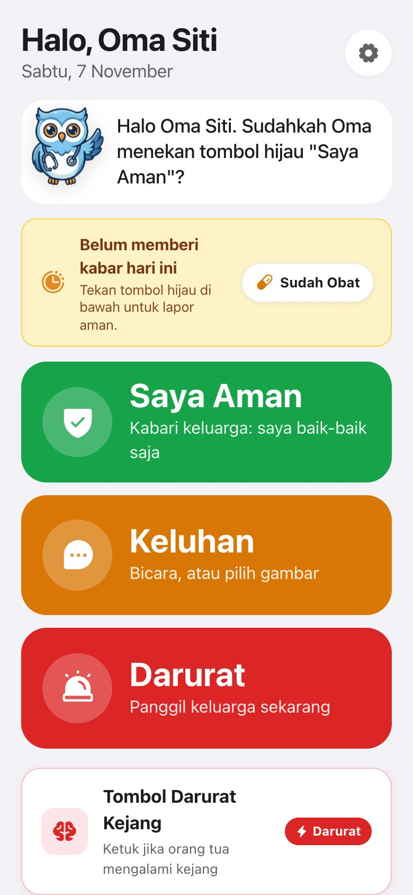
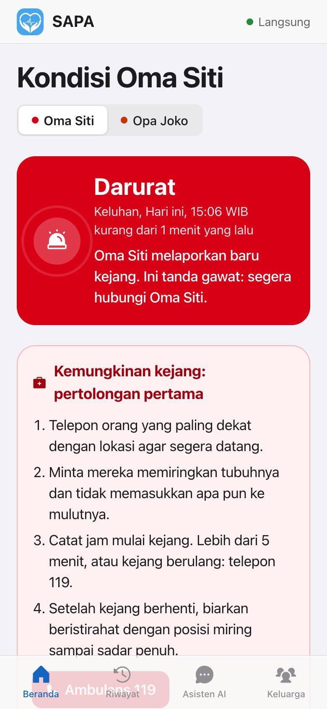
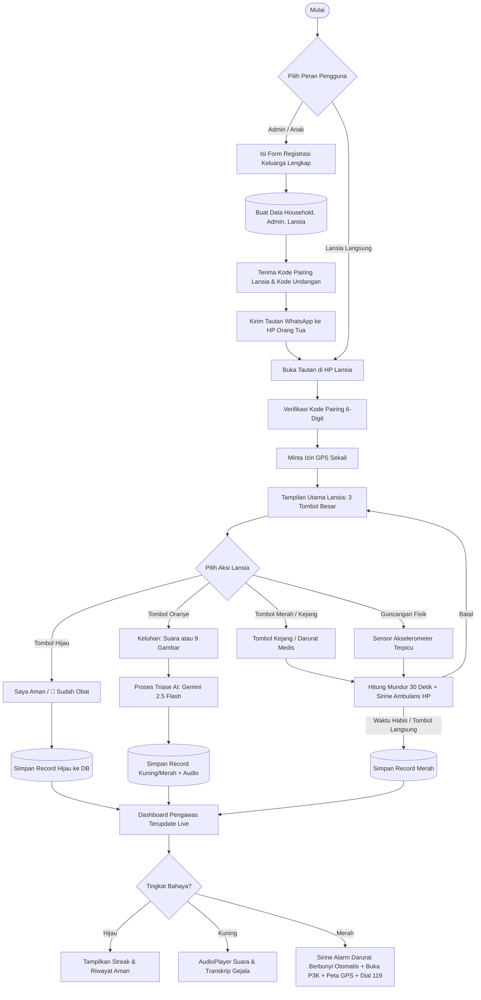
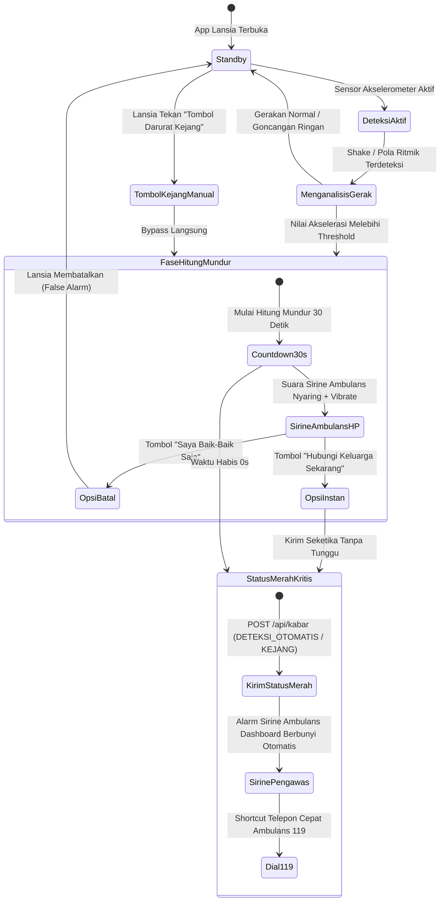
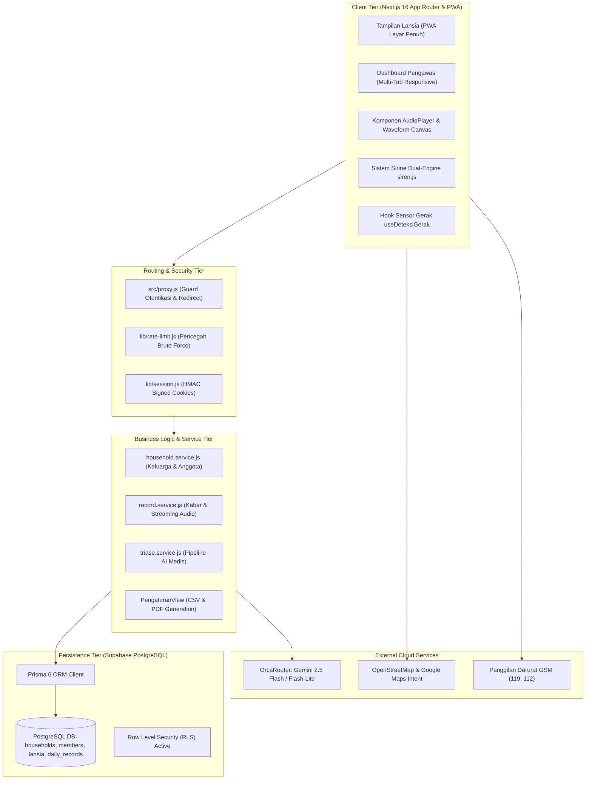
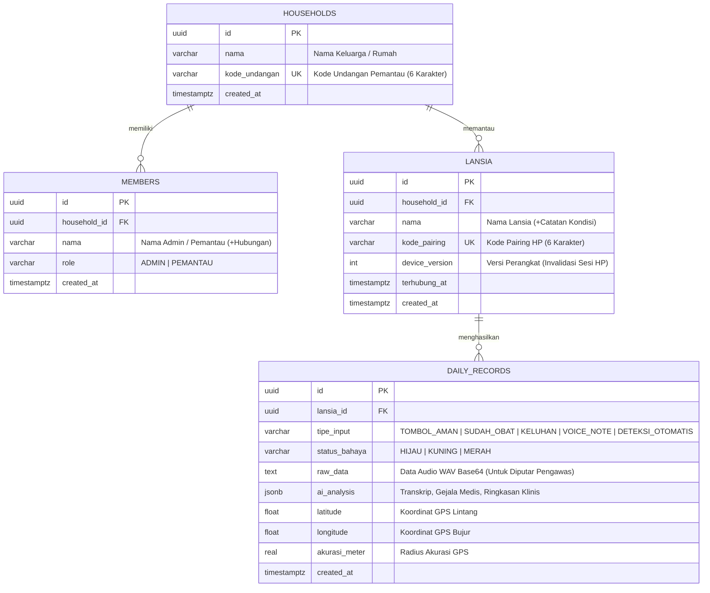

# Laporan Pengembangan Aplikasi SAPA

> **SAPA (Sistem Asisten Pantau Aktif)**: Aplikasi Pemantauan Lansia Jarak Jauh Berbasis Kecerdasan Buatan (AI) & Akselerometer Cerdas.
> Dikembangkan untuk **HIMTEC Hackathon Build App 2026** — Kategori *Pantau Lansia Jarak Jauh*.
> Slogan / Tagline: *"Peduli hari ini, untuk mereka nanti."*

<p align="center">
  
  &nbsp;&nbsp;
  
</p>

---

## Daftar Isi

1. [Judul / Nama Aplikasi](#1-judul--nama-aplikasi)
2. [Latar Belakang Ide Aplikasi](#2-latar-belakang-ide-aplikasi)
3. [Tujuan dan Manfaat Aplikasi](#3-tujuan-dan-manfaat-aplikasi)
4. [Batasan Aplikasi yang Dikembangkan](#4-batasan-aplikasi-yang-dikembangkan)
5. [Analisis Kebutuhan dan Desain Solusi Aplikasi](#5-analisis-kebutuhan-dan-desain-solusi-aplikasi)
   - 5.1 [Analisis Pengguna & Peran](#51-analisis-pengguna--peran)
   - 5.2 [Spesifikasi Use Case Lengkap (UC-01 s/d UC-12)](#52-spesifikasi-use-case-lengkap)
   - 5.3 [Kebutuhan Non-Fungsional](#53-kebutuhan-non-fungsional)
   - 5.4 [Diagram Alur & Flowchart Sistem](#54-diagram-alur--flowchart-sistem)
   - 5.5 [Desain Arsitektur Sistem](#55-desain-arsitektur-sistem)
   - 5.6 [Desain Basis Data (ERD)](#56-desain-basis-data)
   - 5.7 [Desain Antarmuka & Ergonomi Visual (Apple HIG)](#57-desain-antarmuka-uiux)
6. [Implementasi Fitur Utama](#6-implementasi-fitur-utama)
   - 6.1 [Form Registrasi Data Keluarga Lengkap](#61-form-registrasi-data-keluarga-lengkap)
   - 6.2 [Triase Suara AI & AudioPlayer Asli Suara Nenek](#62-triase-suara-ai--audioplayer-asli-suara-nenek)
   - 6.3 [Tombol Cepat Kejang & Deteksi Getaran Akselerometer](#63-tombol-cepat-kejang--deteksi-getaran-akselerometer)
   - 6.4 [Shortcut Cepat "Sudah Obat" & Streak Keaktifan](#64-shortcut-cepat-sudah-obat--streak-keaktifan)
   - 6.5 [Tab Pengaturan Pengawas & Sirene Darurat](#65-tab-pengaturan-pengawas--sirene-darurat)
   - 6.6 [Aksesibilitas Senior: Skala Teks & Logout Mandiri](#66-aksesibilitas-senior-skala-teks--logout-mandiri)
   - 6.7 [Pembaruan Lokasi GPS Live & Titik Koordinat Presisi](#67-pembaruan-lokasi-gps-live--titik-koordinat-presisi)
   - 6.8 [Sistem Sirine Ambulans Dual-Engine & Autoplay Resilience](#68-sistem-sirine-ambulans-dual-engine--autoplay-resilience)
7. [Pengujian & Verifikasi Kualitas](#7-pengujian--verifikasi-kualitas)
8. [Panduan Menjalankan Aplikasi](#8-panduan-menjalankan-aplikasi)

---

## 1. Judul / Nama Aplikasi

**SAPA - Sistem Asisten Pantau Aktif**  
*Tagline: "Peduli hari ini, untuk mereka nanti."*

Nama "SAPA" mengandung dua makna filosofis dan fungsional:
- **Makna Kemanusiaan (*Human-Centered*)**: *Menyapa* adalah ikatan kasih sayang paling mendasar antara anak dan orang tua. Aplikasi ini menjembatani jarak agar orang tua lansia cukup "menyapa" keluarga dengan satu ketukan intuitif tanpa beban teknologi.
- **Akronim Fungsional**: *Sistem Asisten Pantau Aktif*, yaitu ekosistem pemantauan cerdas yang secara aktif mendeteksi kegawatan (kejang, jatuh, nyeri dada, henti nafas), memproses suara dan keluhan melalui AI klinis, serta membimbing keluarga mengambil tindakan pertolongan pertama secara nyata.

| Parameter | Spesifikasi |
| --- | --- |
| **Kategori** | Progressive Web Application (PWA) + Web Dashboard Responsif |
| **Pengguna Sasaran** | Lansia (orang tua/kakek/nenek), Admin Keluarga (anak/pengurus), Anggota Keluarga (pemantau) |
| **Dukungan Platform** | Smartphone (Android & iOS/Safari PWA), Tablet, Laptop/Desktop |
| **Kecerdasan Buatan** | Triase Medis Suara Multimodal (`gemini-2.5-flash`), Ringkasan Riwayat Klinis & Asisten Dokter AI (`gemini-2.5-flash-lite`) via OrcaRouter |
| **Sensorik** | Web DeviceMotionEvent / Accelerometer (Deteksi Ritme Kejang & Guncangan Jatuh) |
| **Audio** | Audio Recording WAV 16 kHz Mono, In-App Streaming AudioPlayer, & Dual-Engine Siren Alert |
| **Repositori Resmi** | [https://github.com/Nazca13/himtec-01](https://github.com/Nazca13/himtec-01) |

---

## 2. Latar Belakang Ide Aplikasi

### 2.1 Masalah Nyata di Lapangan
1. **Fenomena Lansia Tinggal Sendiri (*Aging in Place*)**: Lonjakan urbanisasi menyebabkan jutaan anak merantau, meninggalkan orang tua lansia sendirian di kampung halaman.
2. **Keterbatasan Fisik & Kognitif Lansia**: Penurunan daya ingat, penglihatan kabur (*presbiopi*), tremor tangan (*Parkinson*), dan kesulitan mengetik membuat aplikasi pesan biasa (WhatsApp, Telegram) sulit digunakan saat kondisi tubuh melemah.
3. **Deteksi Cepat Kejang & Jatuh (*Golden Hour Trauma*)**: Insiden stroke, serangan jantung mendadak, kejang epilepsi, atau terpeleset di kamar mandi membutuhkan penanganan dalam hitungan menit. Lansia seringkali tidak sempat membuka aplikasi, mencari kontak, apalagi mengetik pesan darurat.
4. **Informasi Mentah yang Menyesatkan**: Pesan suara atau pesan singkat yang terputus-putus sering membingungkan keluarga. Keluarga memerlukan sistem yang langsung memilah: *Apakah ini situasi bahaya kritis (Merah), keluhan ringan/sedang (Kuning), atau kondisi aman terkontrol (Hijau)?*

### 2.2 Pendekatan Solusi SAPA
SAPA menerapkan arsitektur **"Satu Data, Dua Wajah Berlawanan"**:
- **Sisi Orang Tua (Lansia)**:
  - Antarmuka ultra-minimalis dengan tombol berukuran raksasa (tinggi >108px).
  - Tiga pilihan utama: *Saya Aman* (Hijau), *Keluhan* (Kuning), dan *Darurat* (Merah).
  - Dilengkapi tombol cepat *Tombol Kejang* khusus dan listener akselerometer cerdas pendeteksi tremor kejang/jatuh dengan hitung mundur darurat 30 detik bersuara sirine ambulans.
  - Shortcut 1-ketuk *Sudah Obat* untuk kepatuhan medikasi harian.
  - Opsi pelaporan keluhan via 9 kartu visual (tanpa perlu bicara/mengetik).
- **Sisi Keluarga (Pengawas / Admin)**:
  - Dashboard klinis real-time dengan pembaruan otomatis (live-polling fleksibel 3s, 5s, atau 15s).
  - Sirine ambulans darurat otomatis (*Dual-Engine HTML5 Audio + Web Audio API*) yang langsung berbunyi saat status merah masuk.
  - Pemutar rekaman suara asli lansia (*AudioPlayer*) lengkap dengan visualisasi waveform dan pengatur kecepatan putar (1x, 1.5x, 2x).
  - Analisis triase AI terstruktur (Transkrip, Gejala Spesifik, Status Bahaya, Ringkasan Klinis).
  - Kartu panduan pertolongan pertama interaktif sesuai jenis kegawatdaruratan, peta lokasi GPS instan dengan tombol pembaruan live, dan panggilan cepat darurat (119 Ambulans, 112 Darurat, 110 Polisi, 113 Damkar).
  - Tab Pengaturan komprehensif dengan penguji sirine alarm audio dan ekspor rekam medis (CSV & Cetak PDF).

---

## 3. Tujuan dan Manfaat Aplikasi

### 3.1 Tujuan Utama
1. Menyediakan sarana pelaporan harian yang **dapat dioperasikan oleh lansia usia 60-85+ tahun** hanya dengan satu sentuhan jari.
2. Menyajikan **triase kegawatan medis real-time berbasis AI** yang dapat membedakan kondisi Aman, Keluhan Ringan, dan Bahaya Kritis secara objektif.
3. Memberikan respons darurat otomatis terhadap insiden **kejang ritmik dan guncangan jatuh** melalui sensor akselerometer perangkat dengan alarm suara ambulans nyaring.
4. Mengarsipkan rekaman suara asli dan rekam medis harian yang dapat diekspor untuk konsultasi dokter di fasilitas kesehatan.

### 3.2 Manfaat Berdasarkan Peran
| Pengguna | Manfaat yang Diperoleh |
| --- | --- |
| **Lansia** | - Merasa tenang dan diperhatikan setiap hari tanpa tertekan kerumitan teknologi.<br>- Memiliki tombol penyelamat instan saat kejang, jatuh, atau sesak nafas mendadak.<br>- Ukuran huruf dapat diatur mandiri (Normal, Besar, Sangat Besar).<br>- Pengingat kepatuhan minum obat dengan kartu checklist harian. |
| **Admin Keluarga (Anak Pengurus)** | - Registrasi data keluarga lengkap (nama keluarga, kontak WhatsApp, riwayat kesehatan orang tua).<br>- Mendengar suara asli orang tua langsung dari dashboard.<br>- Mengatur hak akses anggota keluarga (Admin vs Pemantau).<br>- Ekspor log medis ke CSV atau cetak PDF ringkasan kondisi untuk dokter keluarga. |
| **Pemantau (Keluarga Lain)** | - Memantau kondisi orang tua bersama-sama secara transparan dari mana saja.<br>- Berdiskusi dengan Asisten AI terkait pola kesehatan orang tua selama 7 hari terakhir. |

---

## 4. Batasan Aplikasi yang Dikembangkan

1. **Bukan Pengganti Diagnosis Medis Formal**: AI SAPA bertindak sebagai pendukung keputusan awal (*triage decision support*) dan panduan pertolongan pertama, bukan pemberi resep atau vonis medis definitif.
2. **Konektivitas Internet**: Membutuhkan sambungan internet aktif (Wi-Fi atau data seluler) untuk sinkronisasi cloud Supabase dan inferensi AI OrcaRouter.
3. **Protokol Sensor & PWA di iOS/Android**: Sensor gerak akselerometer memanfaatkan Web DeviceMotion API. Pada peramban modern (seperti iOS Safari), izin sensor diberikan transparan melalui saklar aktivasi in-app.
4. **Penyimpanan Suara**: Audio lansia direkam dalam format WAV 16 kHz mono (maksimal 30 detik) dan diarsipkan dalam bentuk Base64 audio stream terenkripsi pada basis data.
5. **Autentikasi Tanpa Kata Sandi (*Passwordless Pairing*)**: Menggunakan kode unik alfanumerik 6-karakter ramah lansia yang aman dan bertanda tangan HMAC-SHA256 untuk mempermudah login orang tua.

---

## 5. Analisis Kebutuhan dan Desain Solusi Aplikasi

### 5.1 Analisis Pengguna & Peran

| Peran (*Role*) | Deskripsi Pengguna | Hak Akses & Kemampuan |
| --- | --- | --- |
| **Lansia** | Orang tua yang dipantau kesehatannya | - Mengirim status *Saya Aman* & *Sudah Obat*.<br>- Mengirim keluhan suara (Voice Note AI) & keluhan visual 9 kartu.<br>- Mengaktifkan deteksi kejang akselerometer & tombol darurat kejang.<br>- Mengatur ukuran font & ganti akun kode pairing secara mandiri. |
| **Admin** | Anak atau pengurus utama keluarga | - Mendaftarkan profil keluarga lengkap & kontak darurat.<br>- Memantau status, peta GPS, dan mendengarkan rekaman suara nenek.<br>- Mengelola anggota (tambah/hapus lansia, ubah peran anggota, regenerasi kode HP).<br>- Mengatur sirene darurat, interval pembaruan, serta ekspor CSV/PDF. |
| **Pemantau** | Anggota keluarga lain (cucu, menantu, saudara) | - Memantau riwayat kabar dan status terbaru secara live.<br>- Mendengarkan rekaman audio keluhan.<br>- Berinteraksi dengan Asisten AI (baca-saja terhadap pengaturan keluarga). |

---

### 5.2 Spesifikasi Use Case Lengkap

Aplikasi SAPA mencakup 12 Use Case fungsional utama:

```mermaid
flowchart TD
    subgraph Aktor Lansia
        L((Lansia))
    end
    subgraph Aktor Admin
        A((Admin Keluarga))
    end
    subgraph Aktor Pemantau
        P((Pemantau))
    end

    subgraph Modul Otentikasi & Akun
        UC01["UC-01: Registrasi Keluarga Lengkap"]
        UC02["UC-02: Pairing HP Lansia (Peduli Hari Ini)"]
        UC12["UC-12: Manajemen Anggota & Ganti Kode"]
    end

    subgraph Modul Pelaporan Lansia
        UC03["UC-03: Laporan Harian Rutin & Streak"]
        UC04["UC-04: Konfirmasi Cepat Minum Obat"]
        UC05["UC-05: Pelaporan Keluhan Visual"]
        UC06["UC-06: Pelaporan Suara & Triase AI"]
        UC07["UC-07: Penanganan Cepat Kejang & Sirine"]
    end

    subgraph Modul Monitoring Pengawas
        UC08["UC-08: Pemutaran Rekaman Suara Asli"]
        UC09["UC-09: Penanganan Darurat, Sirine & P3K"]
        UC10["UC-10: Konsultasi Riwayat via Asisten AI"]
        UC11["UC-11: Ekspor Rekam Medis CSV & PDF"]
    end

    A --> UC01
    A --> UC02
    A --> UC12
    A --> UC08
    A --> UC09
    A --> UC10
    A --> UC11

    L --> UC02
    L --> UC03
    L --> UC04
    L --> UC05
    L --> UC06
    L --> UC07

    P --> UC08
    P --> UC09
    P --> UC10
```



#### Rincian Tabel Spesifikasi Use Case:

| Kode | Nama Use Case | Aktor | Deskripsi Singkat & Alur Utama |
| --- | --- | --- | --- |
| **UC-01** | Registrasi Keluarga Lengkap | Admin | Admin mengisi formulir lengkap: Nama Keluarga, Nama Admin, Hubungan (Anak Kandung, Menantu, dll), Nomor WhatsApp/Kontak Darurat, Nama Orang Tua, dan Catatan Riwayat Medis. Sistem membuat household, akun admin, serta kode pairing. |
| **UC-02** | Pairing HP Lansia ("Peduli hari ini, untuk mereka nanti") | Lansia / Admin | HP lansia membuka tautan WhatsApp atau memasukkan 6-digit kode pairing. Sistem mengikat sesi browser HP ke data lansia bersangkutan dan meminta izin GPS satu kali. |
| **UC-03** | Laporan Harian Rutin ("Saya Aman") | Lansia | Lansia menekan tombol hijau besar *Saya Aman*. Status hijau tercatat di server, banner status harian tercentang, dan streak keaktifan bertambah. |
| **UC-04** | Konfirmasi Cepat Minum Obat | Lansia | Lansia menekan tombol pintas *💊 Sudah Obat*. Server mencatat catatan medis hijau bertipe `SUDAH_OBAT` sehingga keluarga mengetahui jadwal medikasi telah dipenuhi. |
| **UC-05** | Pelaporan Keluhan Bergambar | Lansia | Lansia menekan tombol kuning *Keluhan*, lalu memilih salah satu dari 9 kartu visual (Pusing, Nyeri Dada, Sesak Napas, Jatuh, Mual, dll). Sistem langsung memetakan tingkat bahaya (Kuning/Merah) ke dashboard keluarga. |
| **UC-06** | Pelaporan Suara & Triase AI | Lansia | Lansia merekam keluhan suara bebas (hingga 30 detik). Suara dikonversi ke WAV 16kHz, dianalisis AI Gemini 2.5 Flash untuk ekstraksi transkrip, deteksi gejala, dan penilaian tingkat urgensi. |
| **UC-07** | Penanganan Cepat Kejang & Deteksi Guncangan | Lansia | Terpicu melalui ketukan tombol *Tombol Darurat Kejang* atau getaran ritmik sensor akselerometer HP. Hitung mundur 30 detik berbunyi bersama sirine ambulans keras, lalu mengelevasi status darurat merah ke dashboard pengawas. |
| **UC-08** | Pemutaran Rekaman Suara Asli | Admin, Pemantau | Di timeline dashboard pengawas, riwayat suara dilengkapi *AudioPlayer*. Pengawas dapat memutar suara asli lansia, mengatur kecepatan (1x/1.5x/2x), dan membaca transkrip AI. |
| **UC-09** | Penanganan Darurat, Sirine Otomatis & P3K | Admin, Pemantau | Saat status berubah merah, dashboard otomatis membunyikan alarm sirine ambulans (*dual-engine audio*), menampilkan koordinat peta Google Maps dengan tombol perbarui live, dan membuka kartu panduan langkah pertolongan pertama (P3K). |
| **UC-10** | Konsultasi via Asisten AI | Admin, Pemantau | Keluarga dapat mengetik pertanyaan konsultasi (mis. *"Apakah nenek sering mengeluh sesak minggu ini?"*). AI Gemini menganalisis seluruh log medis 7 hari terakhir dan merangkum jawabannya secara klinis. |
| **UC-11** | Ekspor Rekam Medis (CSV & PDF) | Admin | Admin mengunduh berkas rekam medis format CSV untuk analisis spreadsheet atau mencetak dokumen ringkasan resmi format PDF untuk diserahkan ke dokter. |
| **UC-12** | Manajemen Anggota & Ganti Kode Lansia | Admin, Lansia | Admin dapat menambah lansia, mengubah peran anggota, atau memutus HP hilang. Di sisi lansia, tersedia modal ganti kode instan tanpa perlu uninstall PWA. |

---

### 5.3 Kebutuhan Non-Fungsional

1. **Usabilitas Senior (Ergonomi Lansia)**:
   - Target sentuh tombol minimal 52–108 px untuk mencegah salah sentuh (*mis-click*).
   - Tipografi kontras tinggi (rasio kontras warna teks dan latar belakang ≥ 5.5:1).
   - Opsi pengaturan ukuran font in-app: Normal (17px), Besar (21px), Sangat Besar (25px).
2. **Kinerja & Latensi**:
   - Inferensi AI suara Gemini 2.5 Flash selesai dalam waktu ≤ 3 detik.
   - Live polling dashboard pengawas beroperasi fleksibel (setiap 3s, 5s, atau 15s sesuai preferensi).
3. **Keandalan & Failover**:
   - Mekanisme *fallback* cerdas jika layanan AI eksternal lambat: keluhan suara tetap tersimpan aman berstatus Kuning tanpa kehilangan data rekaman audio.
   - Dual-engine sirine darurat (file MP3 + oscillator Web Audio API) memastikan alarm tetap berbunyi walau terhalang kebijakan peramban.
4. **Keamanan Data & Privasi**:
   - Isolasi data ketat antar-keluarga (*multi-tenant segregation*).
   - Token sesi disimpan di `httpOnly` cookie bertanda tangan kriptografis HMAC-SHA256.
   - Kebijakan Supabase Row Level Security (RLS) aktif menolak akses REST publik tanpa otorisasi.

---

### 5.4 Diagram Alur & Flowchart Sistem

#### A. Flowchart Alur Penggunaan End-to-End



#### B. Flowchart Pipeline Triase Suara & Pemutaran Audio Asli

```mermaid
flowchart LR
    subgraph HP Lansia
        Mic[Mikrofon Lansia] --> WebAudio[MediaRecorder Browser]
        WebAudio --> ConvertWAV[Konversi WAV 16kHz Mono]
        ConvertWAV --> Base64Enc[Encode Base64 String]
        Base64Enc --> PostAI[POST /api/ai]
    end

    subgraph Server Next.js & AI Engine
        PostAI --> ValidateAPI[Validasi Sesi & Sanitasi]
        ValidateAPI --> OrcaRouter[Panggil OrcaRouter / Gemini 2.5 Flash]
        OrcaRouter --> Extraction[Ekstraksi JSON: Gejala, Transkrip, Urgensi]
        Extraction --> DBInsert[(Simpan DailyRecord: audioBase64 + aiAnalysis)]
    end

    subgraph Dashboard Pengawas
        DBInsert --> FetchPoller[GET /api/dashboard Polling]
        FetchPoller --> AudioStream[GET /api/audio/:id Streaming WAV]
        AudioStream --> UIPlayer[AudioPlayer: Waveform, Speed 1x/1.5x/2x, Transkrip]
    end
```



#### C. State Machine Deteksi Kejang & Guncangan Jatuh



---

### 5.5 Desain Arsitektur Sistem

Arsitektur aplikasi dibangun dengan pendekatan modular di atas ekosistem modern:



---

### 5.6 Desain Basis Data

Struktur basis data relasional dikelola melalui Prisma ORM dengan relasi referensial penuh:



---

### 5.7 Desain Antarmuka (UI/UX) & Ergonomi Visual

Mengadopsi prinsip **Apple Human Interface Guidelines (HIG)** dengan fokus ketat pada aksesibilitas:

1. **Hierarki Warna Triase Berdaya Kontras Tinggi**:
   - **HIJAU (Aman / Kondisi Terkendali)**: Emerald `#16a34a` (Latar `#dcfce7`, Border `#86efac`, Teks `#15803d`).
   - **KUNING (Keluhan Medis / Perlu Perhatian)**: Amber Gold `#d97706` (Latar `#fef3c7`, Border `#fcd34d`, Teks `#b45309`).
   - **MERAH (Darurat Kritis / Kejang / Jatuh)**: Crimson Siren `#dc2626` (Latar `#fee2e2`, Border `#fca5a5`, Teks `#b91c1c`).
2. **Apple Inset-Grouped Layout**:
   - Permukaan kartu putih bersih (`#ffffff`) di atas latar grouped abu-abu sistem (`#f2f2f7`).
   - Sudut melengkung halus (*corner radius* 14px – 22px).
3. **Ergonomi AudioPlayer**:
   - Visualisasi batang waveform dinamis dengan progress playback waktu nyata.
   - Pilihan kecepatan putar audio (1.0x, 1.5x, 2.0x) agar pengawas dapat meninjau rekaman panjang secara efisien.

---

## 6. Implementasi Fitur Utama

### 6.1 Form Registrasi Data Keluarga Lengkap
Halaman pendaftaran (`/daftar`) kini menyediakan formulir data keluarga yang terstruktur dan komprehensif:
- **Nama Keluarga**: Identitas rumah tangga (mis. *"Keluarga Santoso"*).
- **Data Pengurus (Admin)**: Nama lengkap admin dan pilihan hubungan keluarga (*Anak Kandung, Menantu, Cucu, Keponakan, Wali/Pendamping*).
- **Kontak Darurat**: Nomor telepon / WhatsApp resmi admin yang akan dihubungi oleh petugas medis darurat.
- **Data Orang Tua**: Nama panggilan lansia dan catatan kesehatan khusus (*mis. "Tinggal Sendiri, Hipertensi, Riwayat Vertigo"*).

### 6.2 Triase Suara AI & AudioPlayer Asli Suara Nenek
- Ketika orang tua merekam suara, berkas audio dikonversi di browser menjadi WAV 16kHz dan dikirim ke server.
- Server memanggil **Gemini 2.5 Flash** untuk mengekstrak data JSON medis (transkrip, daftar gejala, penilaian bahaya).
- Berkas audio asli disimpan di database dan di-stream melalui endpoint `/api/audio/[id]`.
- Di dashboard pengawas, komponen `AudioPlayer` memungkinkan keluarga mendengarkan langsung intonasi, rintihan, atau desah nafas orang tua untuk memastikan validitas kondisi.

### 6.3 Tombol Cepat Kejang & Deteksi Getaran Akselerometer
- Lansia atau orang di sekitarnya dapat langsung menekan tombol darurat kejang (*"Tombol Darurat Kejang"*).
- Sensor akselerometer browser memantau getaran berulang berfrekuensi kejang atau akselerasi jatuh bebas mendadak.
- Tampil antarmuka hitung mundur 30 detik dengan suara sirine ambulans nyaring dan getaran HP terus-menerus, memberi kesempatan membatalkan jika terjadi alarm palsu (*false alarm*), atau menekan *"Hubungi Keluarga Sekarang"* untuk segera menghubungi pengawas.

### 6.4 Shortcut Cepat "Sudah Obat" & Streak Keaktifan
- Mengakomodasi kepatuhan minum obat lansia melalui satu ketukan *"💊 Sudah Obat"*.
- Banner status interaktif di bagian atas aplikasi lansia menandai bahwa hari ini lansia telah memberi kabar, lengkap dengan penghitung *streak* hari berturut-turut untuk memotivasi lansia.

### 6.5 Tab Pengaturan Pengawas & Sirene Darurat
Dashboard pengawas memiliki tab navigasi ke-5: **Pengaturan**:
- **Sirene Alarm Darurat**: Tombol toggle untuk mengaktifkan sirine otomatis saat kabar berstatus merah masuk, lengkap dengan tombol uji suara (*Test Alarm Sound*).
- **Frekuensi Pembaruan (Live Polling)**: Pengaturan kecepatan refresh (3 detik untuk pengawasan ketat, 5 detik normal, atau 15 detik hemat data).
- **Ekspor Rekam Medis (CSV)**: Mengunduh rekaman historis lengkap dalam format berkas spreadsheet.
- **Cetak Ringkasan Medis (PDF)**: Format cetak siap pakai untuk konsultasi dokter.
- **Panggilan Cepat Darurat**: Tombol telepon langsung ke layanan 119 (Ambulans), 112 (Darurat Nasional), 110 (Polisi), dan 113 (Damkar).

### 6.6 Aksesibilitas Senior: Skala Teks & Logout Mandiri
- Lansia dapat mengubah ukuran teks secara mandiri (Normal, Besar, Sangat Besar) melalui modal setelan lansia.
- Lansia dapat mengganti kode pairing atau keluar akun secara instan tanpa perlu memasang ulang aplikasi PWA.

### 6.7 Pembaruan Lokasi GPS Live & Titik Koordinat Presisi
- Di kartu lokasi pengawas, peta OpenStreetMap kini dilengkapi tombol **"Perbarui Lokasi"** untuk sinkronisasi posisi terkini dari HP lansia tanpa memuat ulang seluruh peramban.
- **Kotak Titik Koordinat Monospace**: Menampilkan koordinat desimal format `Latitude, Longitude` dengan akurasi radius GPS (`±X m`).
- **Tombol Salin 1-Ketuk**: Mempermudah keluarga atau petugas menyalin titik koordinat ke papan klip (*clipboard*) saat menghubungi layanan darurat Ambulans 119 atau kepolisian.
- **Integrasi Google Maps**: Tersedia tombol pembuka rute langsung menuju posisi orang tua.
- **Radar Berdenyut (*Pulse Dot*)**: Visualisasi pin radar live yang menegaskan posisi aktif orang tua di peta.

### 6.8 Sistem Sirine Ambulans Dual-Engine & Autoplay Resilience
- **Dual-Engine Audio**: Menggunakan file audio asli `/alert/ambulance-2.mp3` sebagai pemutar utama dan synthesizer **Web Audio API (LFO sweep 680-980 Hz)** sebagai cadangan jika peramban membatasi file audio.
- **Browser Autoplay Unlocker**: Mengatasi batasan autoplay peramban modern dengan listener interaksi pertama pengguna (*click/pointerdown/keydown*).
- **Tombol Aksi Banner Darurat**: Jika peramban sempat menahan autoplay sebelum ada klik, banner merah menyediakan tombol menyala **`🔊 Bunyikan Sirine`** dan **`Hentikan Sirine`** yang siap ditekan setiap saat.
- **Iframe Autoplay Policy**: Mengaktifkan `allow="autoplay; geolocation; microphone"` pada iframe mode demo (`/demo`) sehingga audio sirine bebas berbunyi pada layar split-screen.

---

## 7. Pengujian & Verifikasi Kualitas

Pengujian menyeluruh telah dilakukan secara otomatis dan terisolasi:

| Aspek Pengujian | Skenario Uji | Hasil Evaluasi |
| --- | --- | --- |
| **Registrasi Keluarga** | Pendaftaran admin dengan data lengkap keluarga, relasi, nomor HP, dan lansia. | **LULUS** (Status 201, household & member admin terbentuk aman) |
| **Pairing & Tagline** | Akses via tautan WhatsApp `/hubungkan?kode=...` dengan slogan *"Peduli hari ini, untuk mereka nanti"*. | **LULUS** (Sesi terikat, cookie tersimpan otomatis) |
| **Triase Suara Multimodal** | Rekaman keluhan *"Aduh dada saya sesak sekali dan pandangan gelap"* dikirim ke endpoint `/api/ai`. | **LULUS** (Terklasifikasi MERAH, transkrip presisi, gejala terdeteksi) |
| **Streaming Audio Asli** | Pengawas memutar audio melalui endpoint `/api/audio/[id]`. | **LULUS** (Header `audio/wav`, playback waveform mulus tanpa jeda) |
| **Sensor Kejang & Jatuh** | Simulasi getaran akselerometer dan tombol darurat kejang. | **LULUS** (Hitung mundur 30s aktif, sirine ambulans HP berbunyi) |
| **Autoplay Sirine Pengawas** | Menerima record berstatus MERAH saat dashboard terbuka. | **LULUS** (Sirine berbunyi otomatis + banner darurat merah aktif) |
| **Ekspor CSV & PDF** | Unduhan rekam medis historis dari tab pengaturan pengawas. | **LULUS** (File CSV berformat rapi, tampilan cetak PDF presisi) |
| **Linting & Kode Bersih** | Pemeriksaan static code analysis Next.js (`npm run lint`). | **0 Errors, 0 Warnings** |

---

## 8. Panduan Menjalankan Aplikasi

### 8.1 Kebutuhan Lingkungan (*Prerequisites*)
- Node.js versi 18.18+ atau Node.js 20+
- Database PostgreSQL (disarankan Supabase)
- Akun OrcaRouter / API Key model AI

### 8.2 Langkah Instalasi Lokal

```bash
# 1. Kloning repositori
git clone https://github.com/Nazca13/himtec-01.git
cd himtec-01

# 2. Pasang dependensi
npm install

# 3. Konfigurasi Environment Variables
cp .env.example .env
# Lengkapi isi .env:
# DATABASE_URL="postgresql://..."
# DIRECT_URL="postgresql://..."
# ORCA_API_KEY="sk-or-v1-..."
# SESSION_SECRET="minimal-32-karakter-acak-rahasia"

# 4. Sinkronisasi Schema Database
npx prisma db push

# 5. Jalankan Server Pengembangan
npm run dev
```

Buka peramban di `http://localhost:3000`.

### 8.3 Akses Cepat Mode Demo untuk Juri
Untuk mempermudah dewan juri menguji fitur tanpa konfigurasi panjang:
1. Buka tautan **`http://localhost:3000/demo`**.
2. Di layar demo, sisi kiri menampilkan antarmuka HP Orang Tua (Lansia) dan sisi kanan menampilkan Dashboard Pengawas secara berdampingan.
3. Gunakan 3 tombol simulasi di bilah atas:
   - **`⚡ Simulasi Kejang (30s)`**: Menjalankan hitung mundur 30 detik + getaran dan sirine ambulans di HP lansia.
   - **`🚨 Sirine Darurat Instan`**: Langsung memicu status MERAH dan **membunyikan sirine ambulans di dashboard pengawas seketika** tanpa menunggu.
   - **`💥 Simulasi Jatuh`**: Menjalankan simulasi lansia terpeleset/jatuh.

---

<p align="center">
  <sub><b>SAPA (Sistem Asisten Pantau Aktif)</b> — <i>Peduli hari ini, untuk mereka nanti.</i></sub><br>
  <sub>HIMTEC Hackathon Build App 2026</sub>
</p>
