# Laporan Pengembangan Aplikasi SAPA

> **SAPA (Sistem Asisten Pantau Aktif)**: aplikasi pemantauan lansia jarak jauh berbasis AI.
> HIMTEC Hackathon Build App 2026, tema *Pantau lansia jarak jauh*.

<p align="center">
  
  &nbsp;&nbsp;
  
</p>

---

## Daftar Isi

1. [Judul / Nama Aplikasi](#1-judul--nama-aplikasi)
2. [Latar Belakang Ide Aplikasi](#2-latar-belakang-ide-aplikasi)
3. [Tujuan dan Manfaat Aplikasi](#3-tujuan-dan-manfaat-aplikasi)
4. [Batasan Aplikasi yang Dikembangkan](#4-batasan-aplikasi-yang-dikembangkan)
5. [Analisis Kebutuhan dan Desain Solusi Aplikasi](#5-analisis-kebutuhan-dan-desain-solusi-aplikasi)
6. [Implementasi Aplikasi](#6-implementasi-aplikasi)

---

## 1. Judul / Nama Aplikasi

**SAPA - Sistem Asisten Pantau Aktif**

Nama "SAPA" dipilih karena dua alasan:

- **Makna sehari-hari**: *menyapa* adalah cara paling sederhana menanyakan kabar seseorang. Aplikasi ini membuat orang tua cukup "menyapa" keluarganya dengan satu ketukan.
- **Akronim fungsi**: *Sistem Asisten Pantau Aktif*, yaitu sistem yang secara aktif membantu keluarga memantau kondisi orang tua, bukan sekadar mencatat.

| Atribut | Keterangan |
| --- | --- |
| Jenis | Aplikasi web progresif (PWA) + dashboard web |
| Pengguna | Orang tua (lansia), anak/pengurus keluarga, anggota keluarga lain |
| Platform | Browser di HP (Android/iOS) dan laptop; app lansia bisa di-install ke layar utama |
| Kecerdasan buatan | Triase pesan suara, ringkasan kondisi, asisten tanya-jawab, pesan maskot |
| Repositori | https://github.com/Nazca13/himtec-01 |

---

## 2. Latar Belakang Ide Aplikasi

### 2.1 Kondisi yang diamati

Semakin banyak orang tua di Indonesia tinggal **terpisah dari anak-anaknya**: anak merantau untuk bekerja, sementara orang tua tetap di rumah. Keluarga ingin tahu kabar mereka setiap hari, tetapi:

1. **Menelepon setiap hari tidak selalu memungkinkan.** Jadwal kerja padat, dan telepon yang tidak diangkat justru menimbulkan cemas.
2. **Aplikasi pemantauan yang ada tidak ramah lansia.** Menu bertingkat, formulir, tabel, dan tulisan kecil sulit dipakai orang tua, terutama yang penglihatannya menurun atau tidak terbiasa dengan teknologi.
3. **Saat darurat, lansia tidak sempat mengoperasikan aplikasi.** Tombol SOS kecil atau aplikasi yang harus dibuka lewat beberapa langkah tidak realistis dipakai saat jatuh atau sakit mendadak.
4. **Tidak semua lansia bisa atau mau berbicara/mengetik.** Gangguan bicara, pendengaran, atau rasa sungkan membuat keluhan sering tidak tersampaikan.
5. **Keluarga kebanjiran informasi mentah.** Kalaupun ada laporan, keluarga harus membaca dan menyimpulkan sendiri apakah situasinya berbahaya.

### 2.2 Gagasan

SAPA memisahkan aplikasi menjadi **dua wajah yang sangat berbeda** di atas satu data yang sama:

- **Untuk orang tua: aplikasi tiga tombol besar.** Tanpa menu, tanpa login, tanpa formulir. *Saya Aman* (hijau), *Keluhan* (oranye), *Darurat* (merah). Keluhan bisa diucapkan **atau cukup diketuk lewat gambar**.
- **Untuk keluarga: dashboard yang sudah "berpikir".** AI menerjemahkan rekaman suara menjadi gejala dan tingkat bahaya, merangkum kondisi beberapa hari terakhir, dan menampilkan langkah pertolongan pertama saat ada kondisi darurat.

Orang tua tidak perlu belajar teknologi; teknologinya yang menyesuaikan diri dengan orang tua.

---

## 3. Tujuan dan Manfaat Aplikasi

### 3.1 Tujuan

1. Menyediakan cara **paling sederhana** bagi orang tua untuk memberi kabar setiap hari: satu ketukan.
2. Memberi keluarga **gambaran kondisi yang jelas dan cepat**: status terbaru, ringkasan AI, lokasi, dan riwayat, diperbarui otomatis dalam hitungan detik.
3. **Mempercepat respons saat darurat** dengan status merah otomatis untuk keluhan berbahaya, lokasi terakhir, dan panduan pertolongan pertama.
4. Memungkinkan **beberapa anggota keluarga** memantau bersama dengan **pembagian peran** yang jelas.
5. Menjaga **privasi dan keamanan** data kesehatan keluarga.

### 3.2 Manfaat

| Pihak | Manfaat |
| --- | --- |
| **Orang tua** | Cukup satu ketukan; tidak perlu membaca menu atau mengetik. Keluhan bisa lewat suara atau gambar. Disapa maskot dengan namanya sendiri sehingga terasa ditemani, bukan diawasi. |
| **Anak / pengurus (admin)** | Tahu kabar orang tua tanpa harus menelepon berkali-kali. Mendapat ringkasan dan saran tindakan dari AI. Bisa mengelola beberapa orang tua dan anggota keluarga dari satu tempat. |
| **Anggota keluarga lain (pemantau)** | Ikut memantau tanpa bisa mengubah pengaturan, sehingga data tetap tertib. |
| **Situasi darurat** | Keluhan berbahaya (nyeri dada, sesak, jatuh, kejang) langsung berstatus merah. Keluarga langsung melihat langkah pertolongan pertama, tombol telepon 119/112, dan lokasi terakhir. |

---

## 4. Batasan Aplikasi yang Dikembangkan

Batasan berikut sengaja ditetapkan atau merupakan keterbatasan teknis yang diketahui:

### 4.1 Batasan ruang lingkup

1. **Bukan alat medis dan tidak mendiagnosis.** AI hanya merangkum keluhan dan menilai tingkat urgensi (hijau/kuning/merah). Panduan pertolongan pertama bersifat umum dan tertulis "bukan pengganti tenaga medis".
2. **Tidak menghubungi layanan darurat secara otomatis.** Aplikasi memberi tahu keluarga dan menyediakan tombol telepon 119/112; keputusan menelepon tetap pada manusia.
3. **Tidak ada notifikasi push** ke HP keluarga. Kabar baru tampil di dashboard (diperbarui setiap ±5 detik saat dibuka).
4. **Deteksi jatuh/kejang otomatis tidak disertakan.** Fitur ini sempat dibuat memakai sensor gerak HP, tetapi **dihapus** karena di platform web hanya bekerja saat aplikasi terbuka dan hasilnya tidak konsisten. Fitur yang tidak andal berbahaya karena keluarga bisa mengandalkannya. Sebagai gantinya tersedia tombol *Darurat* dan pilihan keluhan *Jatuh* / *Baru kejang* yang selalu berfungsi.

### 4.2 Batasan teknis

1. **Butuh koneksi internet.** Tanpa internet, aplikasi menampilkan halaman offline dan kabar tidak tersimpan (tidak diantrekan).
2. **HTTPS diperlukan** untuk mikrofon, lokasi, dan pemasangan ke layar utama di HP. Mode pengembangan di jaringan lokal (HTTP) hanya cocok untuk uji tampilan.
3. **Lokasi hanya dikirim saat tombol ditekan** dan hanya jika izin lokasi diberikan; bukan pelacakan terus-menerus.
4. **Rekaman suara maksimal 30 detik** dan dikonversi ke WAV 16 kHz mono di browser sebelum dikirim.
5. **Bergantung pada layanan pihak ketiga**: Supabase (database), OrcaRouter (model AI). Jika AI gagal atau lambat, aplikasi memakai teks cadangan dan pesan suara tetap tersimpan berstatus kuning.
6. **Pembatas percobaan kode disimpan di memori server**, cukup untuk skala demo; untuk skala besar perlu penyimpanan bersama seperti Redis.
7. **Tanpa kata sandi.** Akses memakai kode sekali pakai yang menghasilkan sesi bertanda tangan; keamanan bergantung pada kerahasiaan kode yang dibagikan.

---

## 5. Analisis Kebutuhan dan Desain Solusi Aplikasi

### 5.1 Analisis pengguna dan peran

| Peran | Siapa | Kebutuhan utama | Perangkat |
| --- | --- | --- | --- |
| **Lansia** | Orang tua yang dipantau | Memberi kabar semudah mungkin, tanpa membaca menu | HP sendiri, aplikasi (PWA) |
| **Admin** | Anak/pengurus yang mendaftarkan keluarga | Memantau, mengelola orang tua dan anggota, membagikan kode | Web (laptop/HP) |
| **Pemantau** | Anggota keluarga lain | Memantau tanpa mengubah pengaturan | Web (laptop/HP) |

### 5.2 Kebutuhan fungsional

| Kode | Kebutuhan | Peran |
| --- | --- | --- |
| F-01 | Mendaftarkan keluarga dan orang tua pertama, menjadi admin | Admin |
| F-02 | Menghubungkan HP orang tua sekali saja dengan kode / link WhatsApp | Lansia |
| F-03 | Bergabung ke keluarga dengan kode undangan sebagai pemantau | Pemantau |
| F-04 | Mengirim kabar *Saya Aman* dan *Darurat* dengan satu ketukan | Lansia |
| F-05 | Mengirim keluhan lewat **suara**; AI mentranskripsi, mengenali gejala, menilai bahaya | Lansia |
| F-06 | Mengirim keluhan lewat **gambar** (9 pilihan, satu ketukan) untuk yang sulit bicara | Lansia |
| F-07 | Mengirim lokasi HP bersama kabar (jika diizinkan) | Lansia |
| F-08 | Melihat status terbaru, statistik hari ini, riwayat, grafik 7 hari | Admin, Pemantau |
| F-09 | Ringkasan AI yang diperbarui otomatis setiap ada kabar baru | Admin, Pemantau |
| F-10 | Bertanya ke Asisten AI tentang kondisi orang tua | Admin, Pemantau |
| F-11 | Melihat lokasi terakhir di peta dan membukanya di Google Maps | Admin, Pemantau |
| F-12 | Panduan pertolongan pertama saat status merah | Admin, Pemantau |
| F-13 | Menambah/menghapus orang tua, memutus HP yang hilang (kode baru) | Admin |
| F-14 | Menjadikan anggota admin/pemantau, mengeluarkan anggota | Admin |
| F-15 | Mode demo untuk juri: tampilan HP lansia dan dashboard berdampingan | Publik |

### 5.3 Kebutuhan non-fungsional

| Aspek | Kebutuhan |
| --- | --- |
| **Kemudahan (lansia)** | Hanya 3 tombol besar (≥108 px), teks ≥17 px, tanpa pengaturan di layar orang tua, satu ketukan per tindakan |
| **Kejelasan (keluarga)** | Yang paling penting tampil paling atas; satu kartu langkah awal saat belum ada kabar, bukan kartu-kartu kosong |
| **Kecepatan** | AI menjawab ±2-3 detik; kabar baru muncul di dashboard ±5 detik |
| **Keamanan** | Data terisolasi per keluarga; peran diperiksa di server pada setiap permintaan; database tertutup untuk akses publik |
| **Keandalan** | Kirim ulang otomatis 3x saat koneksi gagal; pesan tidak hilang walau AI gagal |
| **Aksesibilitas** | Kontras warna ≥4,5:1, status tidak hanya dibedakan warna, mendukung pembaca layar dan *reduced motion* |
| **Portabilitas** | Berjalan di HP dan laptop; dapat di-clone dan dijalankan di perangkat lain dengan langkah yang terdokumentasi |

### 5.4 Alur penggunaan

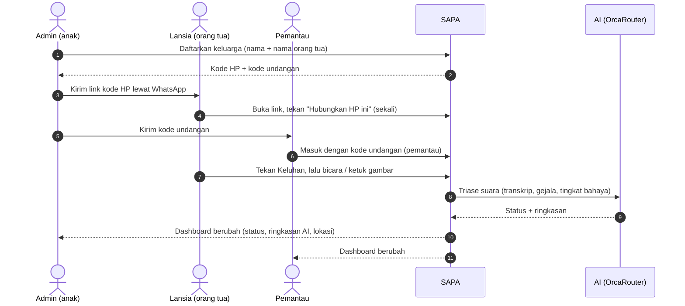

### 5.5 Desain arsitektur

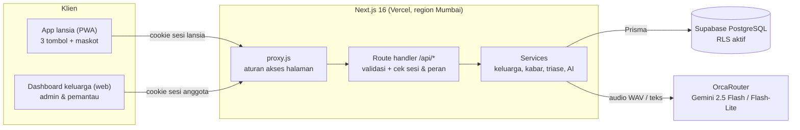

**Keputusan desain utama:**

1. **Satu basis kode, dua wajah.** App lansia dan dashboard keluarga berbagi server dan database, tetapi tampilannya dirancang terpisah sesuai kebutuhan masing-masing.
2. **Status ditentukan server, bukan HP.** HP hanya mengirim *apa yang terjadi* (tombol, keluhan, suara); server yang memutuskan hijau/kuning/merah. Ini mencegah manipulasi dan menjaga konsistensi.
3. **Tanpa kata sandi.** Lansia tidak mungkin diminta mengingat kata sandi; keluarga cukup memakai kode. Sesi disimpan di cookie httpOnly bertanda tangan HMAC.
4. **AI dengan cadangan.** Setiap fitur AI punya teks cadangan agar aplikasi tetap berguna saat AI lambat/gagal.
5. **Server di region yang sama dengan database** (Mumbai) agar setiap query tidak menyeberang benua.

### 5.6 Desain basis data

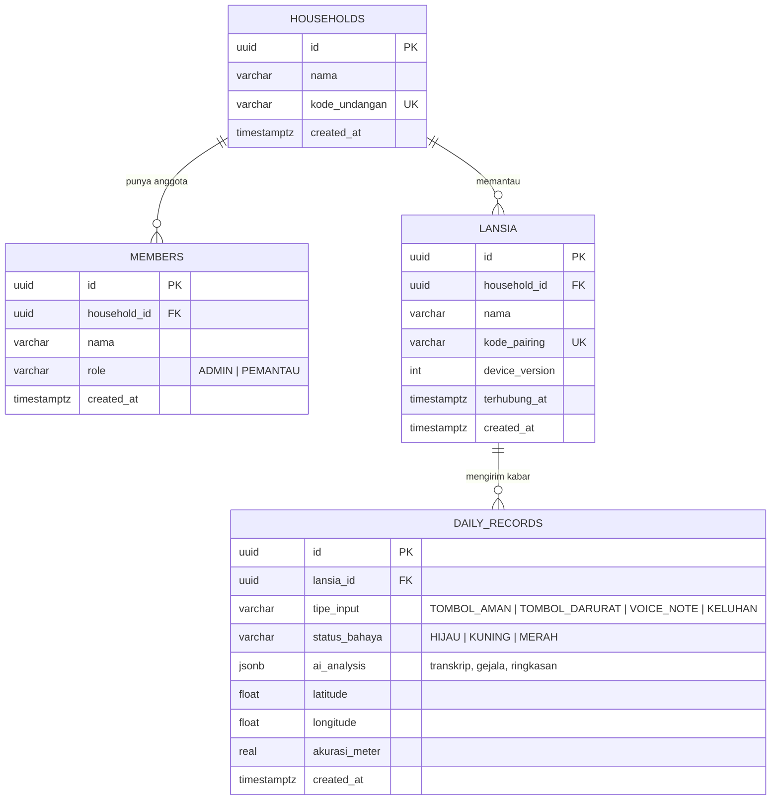

- Semua relasi `ON DELETE CASCADE`: menghapus keluarga menghapus anggota, orang tua, dan kabarnya.
- `CHECK` constraint di database untuk peran, tipe kabar, status, dan rentang koordinat.
- **Row Level Security** aktif di keempat tabel: akses publik ke Data API Supabase ditolak (diverifikasi: HTTP 401).
- `device_version` naik saat admin memutus HP, sehingga sesi HP lama langsung tidak berlaku.

### 5.7 Desain antarmuka (UI/UX)

Antarmuka mengikuti **Apple Human Interface Guidelines** agar terasa bersih, tenang, dan familier, dengan identitas warna dari logo SAPA.

| Elemen | Keputusan |
| --- | --- |
| Warna identitas | Biru logo `#45A7F2`, navy logo `#142445`; tombol/tautan `#1565C0` (kontras 5,75:1) |
| Warna status | Hijau `#248A3D`, oranye `#C93400`, merah `#D70015` (versi aksesibel warna sistem Apple; teks putih ≥4,5:1) |
| Tata letak | Latar abu sistem, kartu putih, daftar *inset grouped*, judul besar rata kiri |
| Tipografi | Font sistem (SF di iPhone/Mac), Inter sebagai cadangan; ukuran dasar 17 px |
| Ikon | Phosphor Icons (tanpa emoji) |
| Maskot | Burung hantu perawat dari logo, menyapa orang tua dan menjadi wajah fitur AI |

**Prinsip untuk orang tua:**

- Layar utama hanya berisi **sapaan + tanggal, maskot, dan tiga tombol**. Tidak ada menu atau pengaturan.
- Setiap tindakan **satu ketukan**: keluhan gambar langsung terkirim tanpa tombol "Kirim" tambahan.
- Pilihan keluhan dibatasi **9 (3×3)** agar muat satu layar tanpa menggulir.
- Setiap kabar dibalas layar penuh **"Pesan Tersampaikan"** dan kalimat maskot yang menyebut nama orang tua.

**Prinsip untuk keluarga:**

- Di HP, urutan kartu mengikuti kepentingan: **status → pertolongan pertama → ringkasan AI → lokasi → statistik → riwayat → grafik**.
- Saat belum ada kabar, tampil **satu kartu langkah awal** (hubungkan HP, coba tombol pertama), bukan kartu kosong.
- Fitur pengelolaan hanya tampil untuk admin; pemantau melihat versi baca-saja.

---

## 6. Implementasi Aplikasi

### 6.1 Teknologi yang digunakan

| Lapisan | Teknologi | Fungsi |
| --- | --- | --- |
| Framework | **Next.js 16** (App Router), React 19, JavaScript | Halaman, API, rendering |
| Database | **Supabase PostgreSQL** + **Prisma 6** | Penyimpanan data, migrasi, query bertipe |
| Kecerdasan buatan | **OrcaRouter** (OpenAI-compatible) → `google/gemini-2.5-flash` (audio), `google/gemini-2.5-flash-lite` (teks) | Triase suara, ringkasan, asisten, pesan maskot |
| PWA | Web App Manifest + service worker buatan sendiri | Install ke layar utama, cache, halaman offline |
| Animasi | `motion` (dimuat malas) + animasi CSS | Umpan balik tombol, perayaan |
| Ikon | `react-icons` (Phosphor) | Ikon konsisten tanpa emoji |
| Peta | OpenStreetMap (embed) + tautan Google Maps | Lokasi terakhir tanpa API key |
| Hosting | Vercel (region `bom1`, Mumbai) | Satu region dengan database |

### 6.2 Struktur proyek

```
src/
  app/            halaman dan route handler (/api/*)
  features/
    lansia/       aplikasi HP orang tua
    pengawas/     dashboard keluarga
    masuk/        halaman depan, daftar, gabung, hubungkan
  components/ui/  komponen bersama (Mascot, ShareCode, StatusBadge, Wordmark)
  services/       logika bisnis (keluarga, kabar, triase, maskot, asisten, demo)
  lib/            database, AI, sesi, otorisasi, kode, lokasi, format
  hooks/          useRecorder (rekam dan ubah ke WAV)
  proxy.js        aturan akses halaman berdasarkan sesi
prisma/           schema, setup.sql (DDL + RLS), sql/ (migrasi), seed
public/           ikon, logo, maskot, service worker, halaman offline
docs/             PRD, dokumentasi Supabase, screenshot
```

### 6.3 Tampilan aplikasi

#### Masuk dan pendaftaran

| Halaman depan (pilih peran) | Daftar sebagai admin | Kode HP dan undangan |
| :---: | :---: | :---: |
| 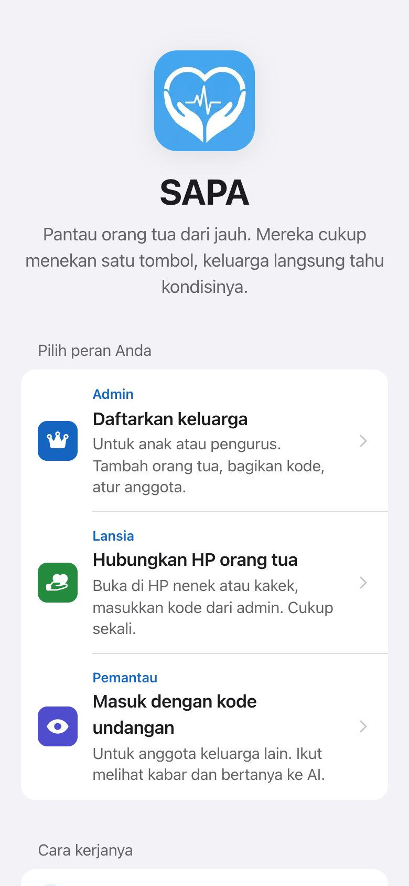 | 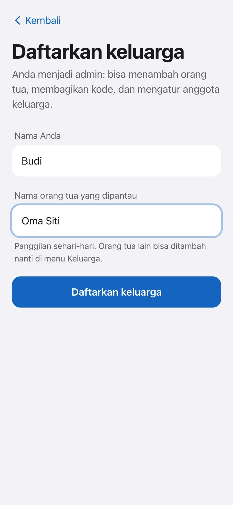 | 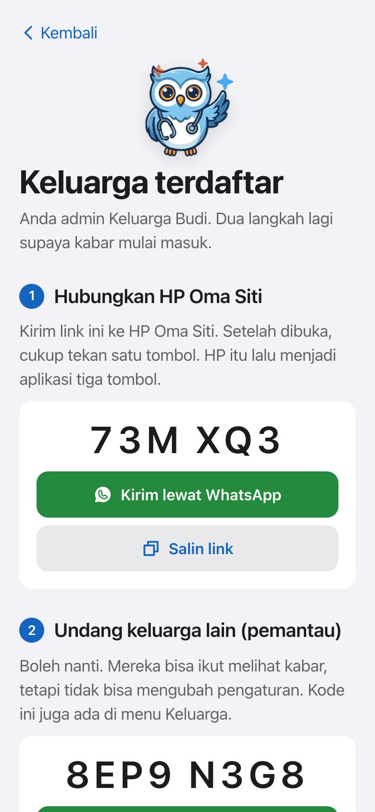 |

#### Aplikasi orang tua (lansia)

| Layar utama | Keluhan lewat gambar | Pesan tersampaikan |
| :---: | :---: | :---: |
|  | 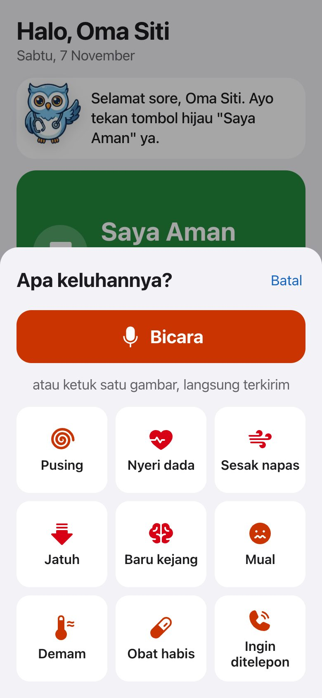 | 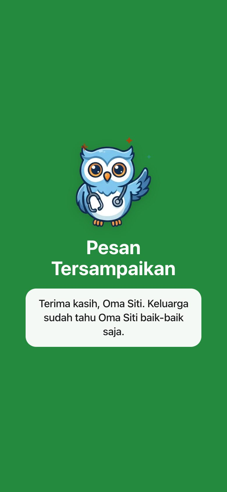 |

#### Dashboard keluarga

**Kondisi normal:**

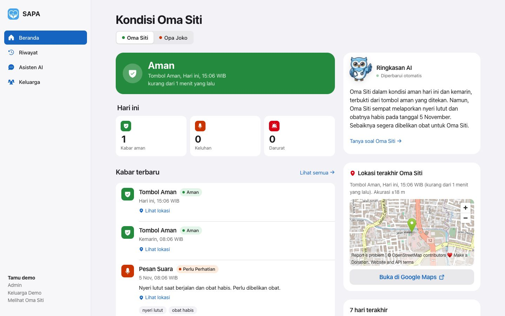

**Saat darurat** (orang tua mengetuk "Baru kejang"): status merah, panduan pertolongan pertama, ringkasan AI, dan lokasi.

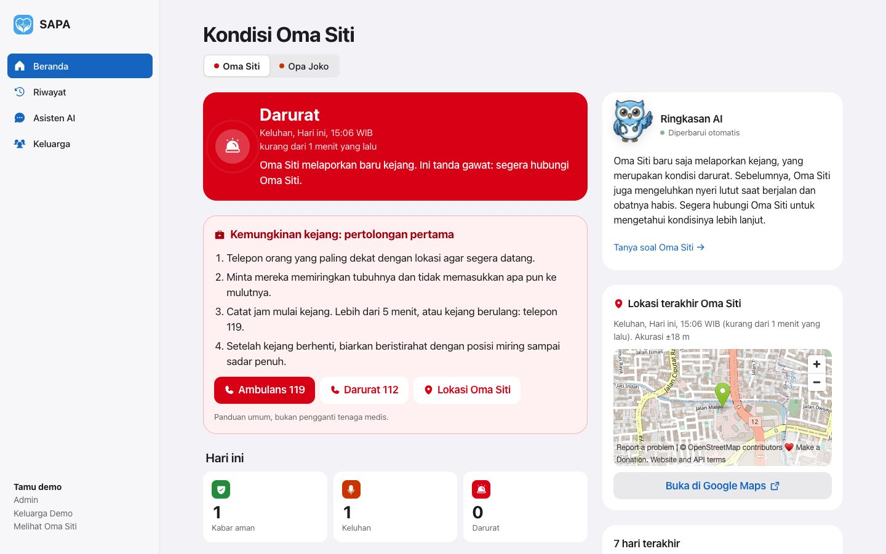

| Dashboard di HP | Kelola keluarga (admin) | Asisten AI | Riwayat |
| :---: | :---: | :---: | :---: |
|  | 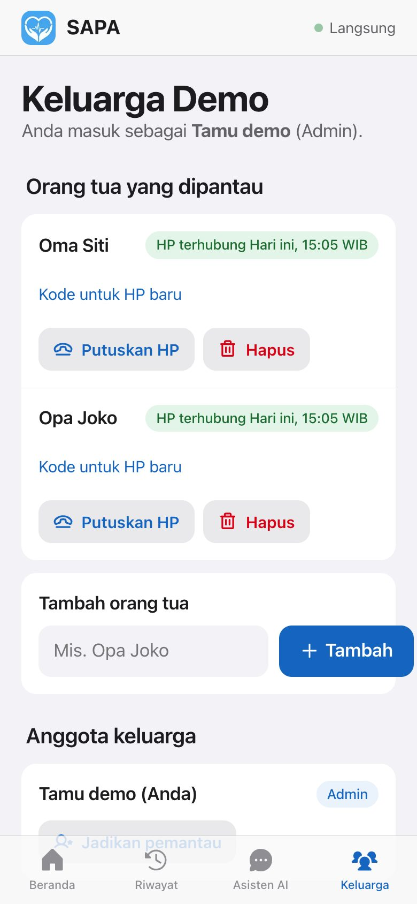 | 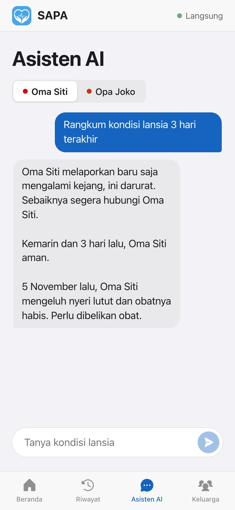 | 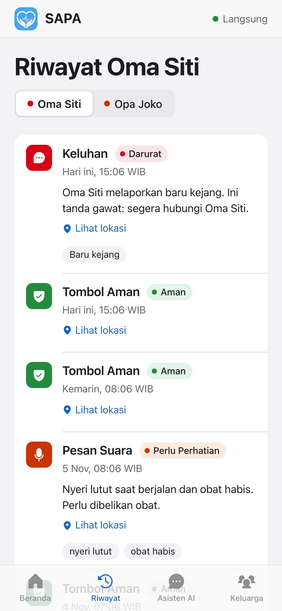 |

#### Mode demo dan panduan

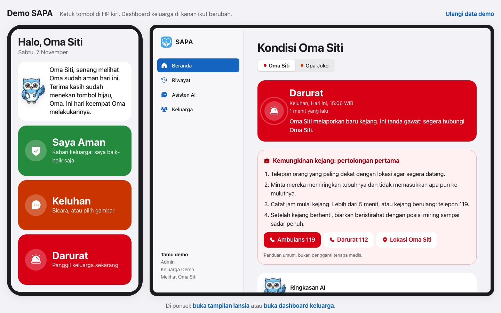

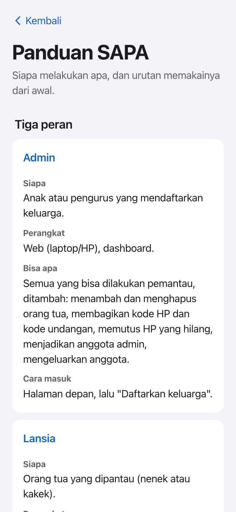

### 6.4 Implementasi fitur utama

**a. Triase pesan suara dengan AI**

1. Browser merekam suara (maks. 30 detik) lalu mengonversinya ke **WAV 16 kHz mono**, karena model AI hanya menerima WAV/MP3, sedangkan Chrome merekam WebM dan Safari MP4.
2. Server mengirim audio ke `gemini-2.5-flash` lewat OrcaRouter dengan instruksi triase dan meminta jawaban **JSON**: `transkrip`, `gejala`, `statusBahaya`, `ringkasan`.
3. Aturan triase: jatuh, nyeri dada, sesak, wajah/tubuh lemah sebelah, bicara pelo, pingsan → **merah**; nyeri, pusing, mual, obat habis → **kuning**; jika ragu pilih tingkat lebih tinggi.
4. Jika AI gagal, pesan tetap tersimpan berstatus **kuning** dengan tanda `fallback`, sehingga keluarga tetap diberi tahu.

Contoh hasil uji dengan rekaman *"Tolong, saya jatuh di kamar mandi dan kaki saya sakit sekali"*:

```json
{
  "transkrip": "Tolong, saya jatuh di kamar mandi dan kaki saya sakit sekali.",
  "gejala": ["jatuh", "nyeri kaki hebat"],
  "statusBahaya": "MERAH",
  "ringkasan": "Pasien lansia jatuh di kamar mandi dan mengeluhkan nyeri hebat pada kakinya."
}
```

**b. Keluhan lewat gambar (tanpa suara)**

Sembilan pilihan: Pusing, Nyeri dada, Sesak napas, Jatuh, Baru kejang, Mual, Demam, Obat habis, Ingin ditelepon. Satu ketukan langsung terkirim. Server memetakan setiap pilihan ke tingkat bahaya; nyeri dada, sesak, jatuh, dan kejang otomatis **merah**.

**c. Ringkasan AI live dan Asisten AI**

- Ringkasan dibuat ulang hanya saat ada kabar baru (kunci cache = id kabar terbaru), memakai waktu relatif seperti "Kemarin, 05:53 WIB" agar AI tidak salah menafsirkan.
- Asisten AI menjawab pertanyaan keluarga berdasarkan kabar 7 hari terakhir orang tua yang dipilih.
- Model teks `gemini-2.5-flash-lite` dipilih setelah pengukuran: **±2,4 detik**, dibanding `orcarouter/auto` yang **30-40 detik**.

**d. Lokasi terakhir**

Saat tombol ditekan, HP mengirim koordinat GPS (jika diizinkan). Pengambilan lokasi **tidak pernah menahan pengiriman lebih dari 3 detik**. Server memvalidasi rentang koordinat, sehingga koordinat palsu dibuang tetapi kabarnya tetap tersimpan.

**e. Peran, sesi, dan keamanan**

- Dua cookie httpOnly bertanda tangan HMAC-SHA256: sesi anggota (`{ m: memberId }`) dan sesi HP lansia (`{ l: lansiaId, v: deviceVersion }`).
- `proxy.js` mengatur akses halaman; setiap API memeriksa ulang sesi dan **peran dibaca dari database** pada setiap permintaan, sehingga perubahan peran dan pengeluaran anggota langsung berlaku.
- Semua query dibatasi ke keluarga/orang tua milik sesi; id dari klien tidak pernah dipercaya.
- Kode dibuat acak tanpa huruf yang mirip (0/O, 1/I); percobaan kode dibatasi per alamat IP.
- Keluarga selalu menyisakan minimal satu admin.

### 6.5 Pengujian

Pengujian dilakukan otomatis terhadap database dan layanan AI sungguhan (Supabase dan OrcaRouter), memakai skrip HTTP dan browser otomatis (Playwright + Google Chrome).

| Pengujian | Cakupan | Hasil |
| --- | --- | --- |
| **Matriks peran dan keamanan** | Daftar, gabung, hubungkan; hak admin vs pemantau vs lansia; admin terakhir tidak bisa turun peran; anggota yang dikeluarkan terkunci; isolasi antar-keluarga; cookie palsu; HP yang diputus; aturan akses halaman | **37/37 lulus** |
| **API kabar** | Saya Aman, Darurat, keluhan kuning/merah, keluhan kosong/palsu/duplikat, tipe tidak dikenal, klien mencoba menentukan status sendiri (diabaikan) | **9/9 lulus** |
| **Alur tiga peran (browser)** | Admin mendaftar → HP lansia terhubung lewat link → kabar masuk tanpa reload → admin menambah orang tua kedua → pemantau bergabung (tanpa akses kelola) → pemantau dinaikkan menjadi admin | **Lulus, tanpa error konsol** |
| **Keandalan "Baru kejang"** | Lima kali berturut-turut dari aplikasi lansia | **5/5 terkirim merah**, panduan pertolongan pertama kejang tampil |
| **Lokasi** | GPS simulasi di browser, koordinat valid/palsu | Lokasi tampil di peta; koordinat palsu dibuang |
| **Triase suara** | Rekaman WAV "saya jatuh..." | Status **merah**, gejala dan ringkasan tepat |
| **Tata letak** | 10 halaman di lebar HP 390 px; scroll dashboard di 1280×720, 1440×600, 390×700, dengan dan tanpa laporan | Tidak ada elemen meluber; semua kartu terjangkau |
| **PWA** | Pemeriksa installability Chrome | Hanya app lansia yang installable; halaman keluarga tidak |
| **Instalasi bersih** | `git clone` → `npm ci` → `build` → jalan, dengan dan tanpa `.env` | Lulus; tanpa `.env` API membalas error yang jelas, tidak crash |

### 6.6 Cara menjalankan

```bash
git clone https://github.com/Nazca13/himtec-01.git
cd himtec-01
npm install
cp .env.example .env    # isi DATABASE_URL, DIRECT_URL, ORCA_API_KEY, SESSION_SECRET
npm run db:push         # buat tabel di Supabase
npm run dev             # buka http://localhost:3000
```

Coba cepat tanpa mendaftar: buka **`/demo`** (HP lansia dan dashboard admin berdampingan dengan data contoh).

Untuk deploy ke Vercel dan detail variabel lingkungan, lihat [`README.md`](README.md). Penjelasan bagi pengguna tersedia di halaman **`/panduan`** di dalam aplikasi.

### 6.7 Pengembangan selanjutnya

1. **Notifikasi push** ke HP keluarga saat status merah (Web Push / WhatsApp).
2. **Pengingat terjadwal**, misalnya mengingatkan orang tua minum obat atau memberi kabar pagi.
3. **Integrasi jam pintar** untuk deteksi jatuh yang andal di latar belakang.
4. **Antrean offline**: kabar disimpan di HP saat tidak ada internet dan dikirim otomatis saat tersambung.
5. **Laporan mingguan** otomatis dari AI untuk keluarga.

---

<p align="center"><sub>SAPA, karena kabar baik dari orang tua seharusnya cukup satu ketukan.</sub></p>
